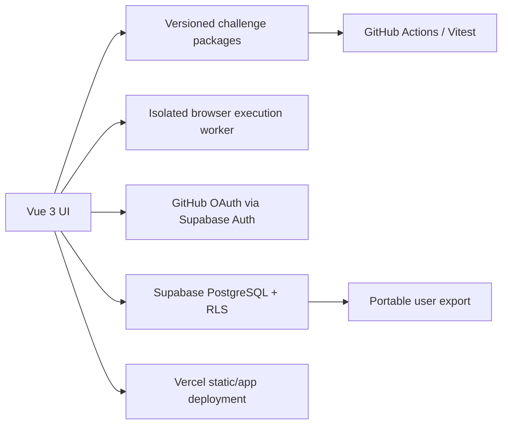

# typescript.lab — Product and Architecture Design

**Status:** Approved by owner on 2026-10-16; implementation gated by scoped plans and security checks.

**Date:** 2026-10-16

**Scope:** Initial platform foundation, learning experience, and a complete first challenge.
**Visual reference:** [Three-screen interactive mockup](../../design/mockups/index.html).

## 1. Intent and success

Build a public, open-source TypeScript interview practice platform for developers preparing for technical assignments, without representing it as affiliated with Google or reproducing proprietary interview materials. People can discover well-defined problems, attempt them, run tests, save their own reasoning and solution history, and revisit old work months later.

The repository must be useful to developers who never use the website. Every challenge's description, starter code, reference solution and tests must be cloneable and runnable locally.

**Initial success condition:** One original challenge (`longest-window`) is available in a coherent Explore → Solve → Save → My Notebook → Retry flow, with deterministic inputs/outputs, tests, optional hints, a reviewable reference solution and exportable user attempts.

### User types

- **Guest:** browse challenges, inspect statements and examples, practise locally/in-browser without a permanent server-side account, read public canonical explanations.
- **Authenticated learner:** additionally autosave private drafts, create immutable attempts, add notes, revisit or compare previous work, export history.
- **Contributor / maintainer:** propose original challenges and maintain canonical educational content via GitHub pull requests.
- **Community reader (later phase):** browse only other people's expressly public attempts, clearly distinguished from reviewed canonical content.

## 2. Product principles

- Solving is the dominant interaction; dashboards must not displace the editor.
- No spoilers by default in Interview Mode: hide pattern/category cues, algorithm-specific hints, reference code and previous attempts while a fresh attempt is underway.
- Editable example inputs and expected output are not equivalent to revealing a solving strategy.
- A user's draft is mutable; a submitted attempt is an immutable historical snapshot.
- Publishing an attempt and saving privately are different actions; sharing is always opt-in.
- Simple, accessible defaults beat streaks, leaderboards and gamification.
- Cloud persistence supplements, never replaces, user-controlled export.

## 3. MVP boundaries

**Included in the first complete vertical slice:**

1. Challenge catalog with title, difficulty, estimated duration, stable identifier, search and a few filters.
2. A challenge detail / Solve route with responsive statement/editor arrangement, deterministic examples, explicit constraints and edge cases.
3. Browser-based TypeScript editing and trustworthy test results produced by executing the user's *current code* through a defined safe boundary.
4. Learning vs Interview modes, with progressive hints and deliberate spoiler-reveal controls.
5. GitHub sign-in, private server-side drafts, explicit immutable submissions, personal notes and a notebook list/detail.
6. Retrying from an empty starter without destroying prior attempts, compare two submissions and export a user's data.
7. The original `longest-window` challenge, including accessible visualization of the sliding-window algorithm in Learning Mode.
8. Keyboard accessibility, light/dark themes and responsive layouts.

**Explicitly deferred:**

- Comments, votes, public browsing of community solutions, leaderboards, moderation and social following.
- Spaced-repetition automation, email reminders, advanced analytics or streak mechanics.
- Multi-language code execution, AI grading, AI feedback, payments or complex user profiles.
- Running arbitrary third-party packages, server-side sandboxes, real-time collaboration.
- Hosted GitHub sync/write-back (download/export is sufficient initially).

The product may visually reserve room for future features, but inaccessible features should not appear as working controls.

## 4. Primary user journeys

### 4.1 Discover and start

**Given** a visitor opens Explore, **when** they search/filter challenges, **then** results accurately reflect the catalog and preserve deep links. Selecting a challenge opens its problem page. A returning logged-in user sees their own last attempt/progress; a guest sees no invented personal statistics.

### 4.2 Solve with independent reasoning

**Given** a challenge with a valid TypeScript signature, **when** a user enters Solve, **then** the editor starts with its starter template or the user's existing draft (never someone else's draft). The problem statement contains input/output contract, return shape, examples, tie-breaking rule, and edge cases.

**Interview Mode:** hide algorithm-name cues and prior solutions by default; show elapsed time without punishing a pause or page revisit. Users must explicitly confirm revealing spoilers, and the choice must be reversible for presentation, not history.

**Learning Mode:** permit three progressive hints, the reference solution, and an algorithm visualization. The challenge's categorization may appear here.

### 4.3 Try examples and run tests

Users can edit example parameters and inspect valid expected output. Running tests evaluates the user's **current editor contents**, not a canonical implementation or hardcoded success status. The UI distinguishes compilation errors, failed assertions, passes, timeouts, unsafe/unsupported execution, and infrastructure failure.

Errors display which case failed and the actual versus expected value when disclosure is appropriate. No tests are represented as truly hidden in a public repository. Avoid misleading green checks in the production UI.

### 4.4 Autosave and submit

For signed-in users, edits debounce into a private draft. Save feedback distinguishes `Saving…`, `Saved`, `Offline / retrying` and `Failed to save`; errors never silently discard the local editor buffer.

Submitting creates a new immutable version containing source code, challenge/version reference, timestamp, evaluation summary and optional notes. A submission can be recorded as failed or untested, but must not be labelled passed unless tests actually ran successfully. A failed network submission leaves the unsent work recoverable.

Guests may practise without signing in; saving to the cloud prompts sign-in. Initial MVP may store a guest draft locally, but must not imply cloud persistence. Upon sign-in, importing local draft requires a clear user action and must not overwrite an existing cloud draft without review.

### 4.5 Remember and retry

My Notebook lists challenges attempted, revision counts, notes and last-worked timestamps. Opening an attempt shows the original code and notes **as recorded**, alongside the challenge version it applied to. Users can compare two attempts without modifying either one. `Retry from scratch` opens a fresh attempt from starter code and hides old solutions until deliberate reveal. Export yields readable, portable source and Markdown/JSON metadata.

### 4.6 Publish (post-MVP)

When public community submissions are introduced, publishing requires explicit confirmation; records remain private until toggled individually. Withdrawal hides the content from public access, and the community interface never confuses a contributor's code with the editorially verified reference solution.

## 5. Challenge contract

Each challenge has a **stable ID**, descriptive title, version, objective, difficulty, estimated duration, topic tags, signature, named inputs/outputs, constraints, deterministic examples, edge cases, progressive hints, canonical solution and automated tests.

Sources of truth:

- Human-facing explanation and constraints: Markdown in the challenge directory.
- Machine-readable metadata and executable example cases: typed TypeScript module(s).
- Starter and reference solutions: separate `.ts` files.
- Practice and canonical test suites: Vitest using shared case fixtures wherever possible.

`longest-window` contract:

```ts
function longestWindow(
  events: string[],
  k: number
): { start: number; endExclusive: number }
```

Find the longest contiguous window containing at most `k` distinct event identifiers. Return an exclusive end index and choose the earliest valid window on ties. Empty events or non-positive `k` return `{ start: 0, endExclusive: 0 }`.

Example: `events = ["A", "B", "A", "C", "B", "B"]` and `k = 2` produce `{ start: 0, endExclusive: 3 }`. The window at indices `3..6` has equal length, so earlier-start tie-breaking matters.

Challenge revision changes must never retroactively change the stored context of previous submissions; the saved version is used to explain or re-run historical attempts.

## 6. Screen contracts and navigation

| Route (accepted) | Purpose | Principal content |
| --- | --- | --- |
| `/` or `/explore` | Discover | Resume, progress summary, search/filterable challenges |
| `/challenges/:slug` | Solve | Description + examples + IDE/editor + tests; modes and hints |
| `/notebook` | Remember | Personal challenge history, review due, search |
| `/notebook/:slug` | Revisit | Immutable attempts, notes, compare, retry, export |
| `/patterns` | Study (later) | Pattern explanations separate from Interview Mode |

**Desktop:** slim persistent navigation, resizable statement/editor split. **Tablet:** flexible split if usable, otherwise tabs. **Mobile:** Problem / Code / Results tabs, with controls always accessible and no horizontal page overflow. Theme toggle and focus visibility are universal. See [design system](../../design/README.md).

## 7. Logical boundaries



- Frontend presentation has no authority to read another user's private records.
- Static challenge content is versioned with the repository and deployable independently of auth/storage.
- The client-side execution environment must be isolated, terminated on timeout and constrained; direct `eval` of untrusted code in the application's window is prohibited. Threat modeling / browser worker limitations must be reviewed before implementation; a Web Worker alone is not claimed to be a perfect security sandbox.
- Server-side persistence uses authenticated ownership enforced by database Row Level Security and explicit uniqueness/immutability constraints.
- Remote test results are not trusted as cryptographic evidence of algorithm correctness. Do not use self-reported client passes for competitive rankings or trusted scoring.

See the accompanying [frontend](../../decisions/0001-frontend-platform.md), [runner](../../decisions/0002-challenges-and-execution.md), and [storage](../../decisions/0003-solution-persistence.md) decision records.

## 8. Quality and non-functional requirements

- **Accessibility:** semantic headings/controls, keyboard-only operation, labelled editor/controls, visible focus, screen-reader-readable test status, accessible descriptions of algorithm visualization, contrast target WCAG 2.2 AA.
- **Performance:** catalog and read-only problem statements render without sign-in; editor and visualization may be lazy-loaded; minimize the initial JS payload.
- **Privacy:** drafts/notes/submissions private by default, never exposed in URLs, logs or analytics. Use least-privilege OAuth scopes and privacy-preserving telemetry.
- **Resilience:** offline/editor text is retained until safely synced; explicit error and retry states for authentication, execution and storage.
- **Security:** prevent arbitrary user code execution in privileged browser or backend contexts, rate-limit relevant write operations, validate and sanitize note content, and configure restrictive policies for embedded runtimes.
- **Portability:** documentation, examples and tests run locally without Supabase, Vercel or authentication. Users can export saved work without proprietary formats.
- **Naming:** the project is independent, not an official Google product or test-question collection.

## 9. Traceable acceptance criteria

| ID | Behaviour | Observable acceptance |
| --- | --- | --- |
| REQ-01 | Challenge portability | Local test command exercises the same canonical cases used in site fixtures |
| REQ-02 | Exact contract | `longest-window` examples, ties, empty input, and `k <= 0` match specification |
| REQ-03 | Independent interview | Interview Mode doesn't show hints, patterns, prior attempts or canonical code without consent |
| REQ-04 | Real execution | Test results depend on current editor code, with failure and timeout states exercised |
| REQ-05 | Draft safety | Autosave confirms server persistence; disconnected edits remain recoverable |
| REQ-06 | Immutable history | Subsequent submission preserves earlier code, notes and challenge version unchanged |
| REQ-07 | Private by default | Cross-account draft/submission reads and writes are denied by RLS |
| REQ-08 | Retry fidelity | Retry opens starter code with no prior solution visible by default |
| REQ-09 | Personal retrieval | Notebook can reopen old attempts, show notes and compare at least two versions |
| REQ-10 | Portability/export | User can download readable code and learning notes without service-specific tooling |
| REQ-11 | Responsive usability | At phone/tablet/desktop widths, primary journeys work without horizontal overflow |
| REQ-12 | Accessible feedback | All primary actions work with keyboard, status is announced, visualization has text alternative |
| REQ-13 | Guest boundaries | A guest can browse/practise and sees a clear login gate for cloud saving |

These criteria govern future implementation tests; the included HTML mockup only demonstrates layout and some local interaction patterns.

## 10. Rollout boundaries and design approval

1. **Design milestone (approved):** SDD spec, accepted ADRs, UX contract and three-screen coded visual prototype.
2. **Foundation milestone:** Vue 3 + Vite + Vue Router, portable challenge package, catalog, CI and Vercel deployment.
3. **Execution milestone:** documented security spike and approved isolated code runner or safe external alternative.
4. **Notebook milestone:** Supabase GitHub OAuth + RLS, editable drafts, immutable attempts, comparison and export.
5. **Polish milestone:** algorithm visualization, mobile refinements, accessibility verification, contributor templates and deployment checks.
6. **Later:** community publishing and optional spaced-repetition.

### Accepted decisions and remaining validation gates

- **Accepted:** plain Vue 3 + Vite + Vue Router first; Nuxt only if a later SSR/SEO requirement justifies it.
- **Accepted:** Vercel deployment of the app, GitHub Actions for CI, hosting-agnostic challenge content.
- **Accepted:** Supabase Auth + PostgreSQL with RLS and GitHub OAuth; introduce private cloud persistence after a locally usable challenge flow.
- **Required technical gate:** validate untrusted code execution via a documented security prototype before shipping a runner.
- **Separate legal decision:** the owner must select and approve an actual license before we assert an open-source license or solicit third-party contributions. Public visibility alone is not a license.

The owner approved the product scope, mockups and ADRs on 2026-10-16. This approval does not override the explicit security, privacy, licensing, billing or deployment gates. See [ROADMAP](../../../ROADMAP.md) and [public implementation plans](../plans/README.md). Optional Codex handoff prompts are maintained locally and are not part of the public repository.
